import Callout from "@components/posts/Callout.astro"

[AVL 树](https://en.wikipedia.org/wiki/AVL_tree) 和 [红黑树](https://en.wikipedia.org/wiki/Red%E2%80%93black_tree) 是两种常见的平衡二叉搜索树。这两种数据结构各有优缺点。在平均情况下，AVL 树有更低的树高度，对于查询操作更加友好。在执行更新操作（即增加或删除节点）时，尤其是在执行删除操作时，相比于 AVL 树，红黑树只需要执行至多常数次旋转操作即可重新平衡，因此在频繁更新的场景下表现更好。

2015 年，Robert E. Tarjan（没错，就是那位提出了离线最近公共祖先算法和有向图强连通分量算法的 Tarjan）等人在论文 [《Rank-Balanced Trees》](https://sidsen.azurewebsites.net/papers/rb-trees-talg.pdf) 中提出了一种新的平衡二叉搜索树结构，名为 Weak AVL 树，简写为 WAVL 树。WAVL 树结合了 AVL 树和红黑树的优点：在平均情况下，WAVL 树拥有和 AVL 树相似的树高度，因此具备和 AVL 树类似的查询友好度；在执行更新操作时，和红黑树类似，WAVL 树也只需要至多常数次旋转操作即可重新达到平衡。

本文将对 WAVL 树的构造和原理进行介绍。

## Rank

要理解 WAVL 树的原理，必须先理解一个称为 rank 的概念。论文《Rank-Based Trees》划分出了一类平衡二叉树，这类平衡二叉树的每个节点 $n$ 都有一个 rank 值 $r\left(n\right)$ 。在达到平衡后，每个节点的 rank 值将会满足某些特定的性质，不同种类的平衡二叉树所满足的 rank 值性质各不相同。

AVL 树、红黑树和 WAVL 树都属于这类平衡二叉树。对于 AVL 树来说，节点的 rank 定义为该节点的高度（一个没有任何子节点的节点的高度在本文中定义为 1）。而对于红黑树来说，节点的 rank 定义为从该节点到以该节点为根节点的子树中的任意一个叶子节点的简单路径上黑色节点的数量。

对于这一类平衡二叉树，围绕 rank 的定义，我们还需要衍生出一个额外的概念。对于一个节点 $n$，记其左子节点的 rank 为 $r_L\left(n\right)$ ，其右子节点的 rank 为 $r_R\left(n\right)$。如果节点没有左子节点或右子节点，则令相应子节点的 rank 为 0 。我们称一个节点为 $\left(x,y\right)$-节点，当且仅当该节点满足以下条件：

$$
\begin{align}
r\left(n\right) - r_L\left(n\right) &= x \\
r\left(n\right) - r_R\left(n\right) &= y
\end{align}
$$

即 $x$ 表示节点与其左子节点的 rank 之差，$y$ 表示节点与其右子节点的 rank 之差。

对于 AVL 树来说，其性质是每个节点都是 $\left(1,1\right)$-节点、$\left(1,2\right)$-节点或 $\left(2,1\right)$-节点。对于红黑树来说，其性质是每个节点都是 $\left(0,0\right)$-节点、$\left(0,1\right)$-节点、$\left(1,0\right)$-节点或 $\left(1,1\right)$-节点。

## WAVL 树的基本性质

AVL 树和红黑树的节点 rank 值是通过树的其他性质计算出来的。另外，AVL 树和红黑树也不依赖于 rank 值来判定树的平衡和执行平衡操作。WAVL 树在这一点上非常不同。首先，WAVL 树节点的 rank 值是人为向节点添加的额外固有属性，就像红黑树中节点的颜色一样，它不依赖于树的其他性质计算得来。其次，WAVL 树完全通过节点的 rank 值来判定树是否平衡，并相应地进行重新平衡操作。重新平衡的过程中，WAVL 树也可能对节点的 rank 值进行调整。

一棵已经达到平衡的 WAVL 树必须满足以下两条性质：

1. 所有叶子节点的 rank 值均为 1 。
2. 所有节点都是 $\left(1,1\right)$-节点、$\left(1,2\right)$-节点、 $\left(2,1\right)$-节点或 $\left(2,2\right)$-节点。

WAVL 树的第二条性质可以等价为，对于 WAVL 树中的每一个非根节点以及每一个外部节点，其父节点与其本身的 rank 值之差一定为 1 或 2 。WAVL 树的所有外部节点的 rank 值均定义为 0 。

WAVL 树和 AVL 树的关系可以用下面这一条性质来总结，即一棵没有 $\left(2,2\right)$-节点的 WAVL 树是一棵合法的 AVL 树。容易知道，此时 WAVL 树中每一个节点的 rank 值就是这个节点的高度。

## WAVL 树的更新操作

### 插入

与所有二叉搜索树一样，在插入一个新节点时，首先需要将这个节点插入为一个叶节点。为满足 WAVL 树的第一条性质，新节点的 rank 值初始化为 1 。在将新节点简单插入为一个叶节点后，我们需要开始考虑两个问题。一是什么时候插入操作会导致 WAVL 变得不再平衡；二是在这样的情况下，应该如何通过旋转操作和调整 rank 值操作使得 WAVL 重新变得平衡。

#### 叶子的情况

在新节点插入为一个叶节点后，观察新节点的父节点的 rank 值，会有两种情况。第一种情况是其父节点在插入新节点之前也是一个叶节点，其 rank 值为 1：


<Callout>
    在本文采用的图示中，圆角矩形代表 WAVL 树中的节点，其中的文字表示节点名称，文字中括号内的数字表示其 rank 值。带有虚线边框的圆形表示外部节点，外部节点的 rank 值定义为 0 。每条 WAVL 树的边上所标记的数字表示这条边所链接的父节点和子节点的 rank 值之差。
</Callout>

此时显然 `parent` 和 `new_node` 的 rank 之差不为 1 或 2 ，违反了 WAVL 树的性质。此时为了恢复 WAVL 树的性质，我们需要将 `parent` 的 rank 值递增，使树变为：

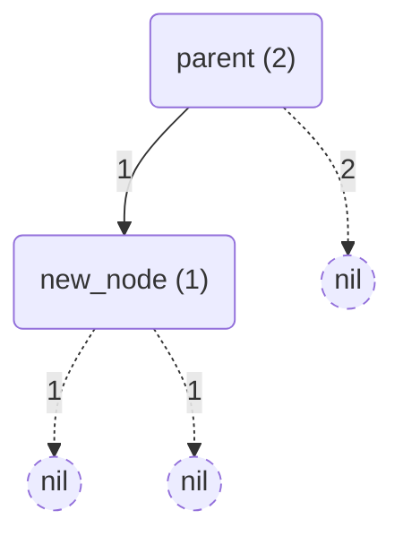

`parent` 节点的 rank 值递增虽然解决了 `parent` 与 `new_node` 的 rank 值之差不符合 WAVL 树性质的问题，但同样可能导致 `parent` 的父节点与 `parent` 节点的 rank 值之差变得不符合 WAVL 树性质。因此，在递增 `parent` 节点的 rank 值之后，我们需要沿着树结构向上一级，继续考虑 `parent` 与其父节点的 rank 值关系。这一步的具体情况将在稍后讨论。

第二种情况是 `parent` 节点的 rank 值为 2：

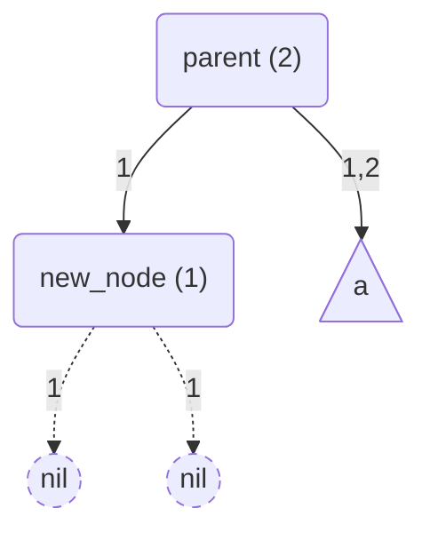

<Callout>
    在本文采用的图示中，三角形表示一个子树。
</Callout>

此时显然所有 WAVL 树的性质均已满足，插入结束。

为什么 `parent` 节点的 rank 值不可能大于 2 呢？假如 `parent` 节点的 rank 值为 3，那么在插入新节点之前，`parent` 节点与新节点所代替的外部节点的 rank 之差将等于 3，这违反了 WAVL 树的性质。

#### 树内部的情况

刚才提到，在递增 `parent` 节点的 rank 值后，需要沿着树结构向上一级继续考虑 `parent` 节点和其父节点的 rank 值关系。为了方便起见，我们把前文提到的 `parent` 节点重命名为 `node` 节点，转而把 `node` 节点的父节点称为 `parent` 节点。

在 `node` 节点的 rank 值递增前，根据 WAVL 树的性质，`parent` 节点和 `node` 节点的 rank 值之差一定为 1 或 2。因此，在 `node` 节点的 rank 值递增后，`parent` 节点和 `node` 节点的 rank 值之差一定为 0 或 1。如果他们的 rank 值之差为后者，那么 WAVL 树的所有性质均已满足，插入结束。因此，我们只需要考虑在递增 `node` 节点的 rank 值之后，`parent` 节点和 `node` 节点的 rank 值之差变为 0 的情况。不妨记 `node` 节点的 rank 值在递增之后为 $r$ ，那么 `parent` 节点的 rank 值也为 $r$ 。

记 `node` 节点的兄弟节点为 `sib` 。当 `sib` 节点的 rank 值为 $r - 1$ 时：

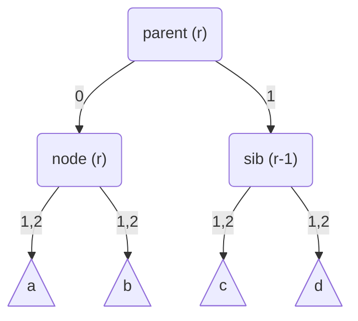

此时我们可以将 `parent` 节点的 rank 值递增，使树变为：

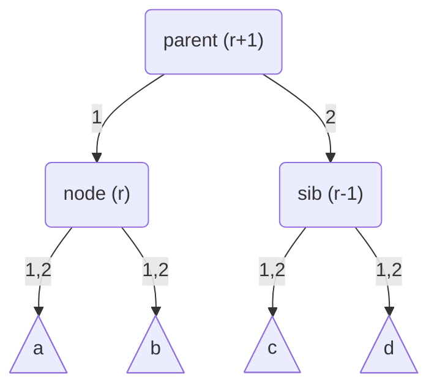

这样，以 `parent` 为根的子树便重新恢复了 WAVL 树的性质。但由于 `parent` 节点的 rank 值被递增，此时同样需要沿树结构向上进一步考虑 `parent` 节点与其父节点的 rank 值关系。

当 `sib` 节点的 rank 值为 $r-2$ 时，情况开始变得复杂起来：

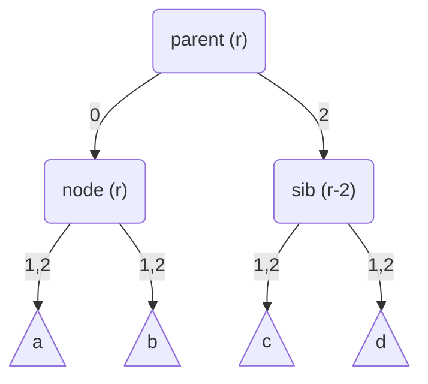

此时我们不能简单地递增 `parent` 节点的 rank 值，因为这样会导致 `parent` 节点和 `sib` 节点的 rank 值之差增大为 3，破坏 WAVL 树的性质。此时，需要对 WAVL 树进行旋转。

在旋转之前，我们需要额外考虑一个节点的 rank 值情况，这个节点是键值比 `node` 节点的键值大但比 `parent` 节点的键值小的 `node` 节点的子节点。在示例图中，`node` 节点是 `parent` 节点的左子节点，因此此时我们需要额外考虑 `node` 节点的右子节点。把这个节点记为 `child` 节点。注意 `child` 节点可能是一个外部节点。

`child` 节点的 rank 值可能为 $r-1$ 或 $r-2$ 。如果 `child` 节点的 rank 值为 $r-2$：

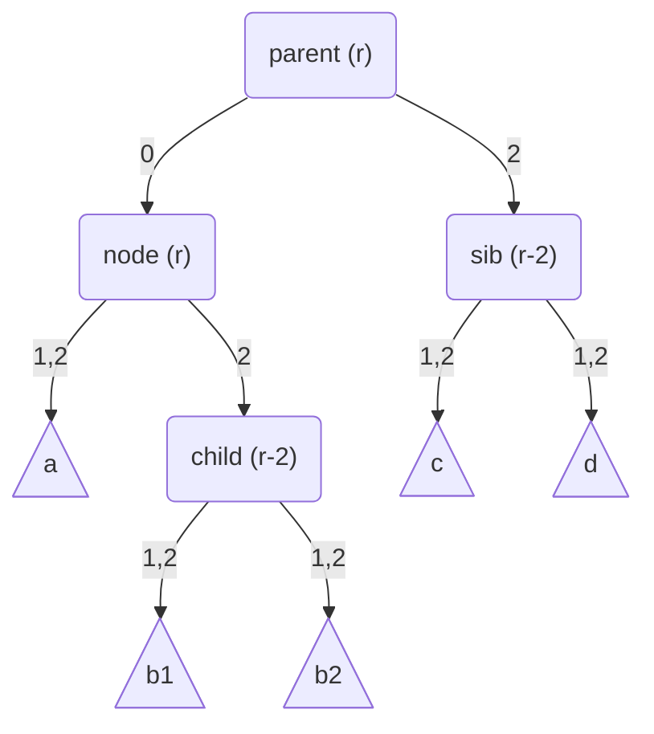

此时我们在 `parent` 节点上执行一次右旋转，把 `node` 节点旋转到 `parent` 节点的位置上，将会得到：

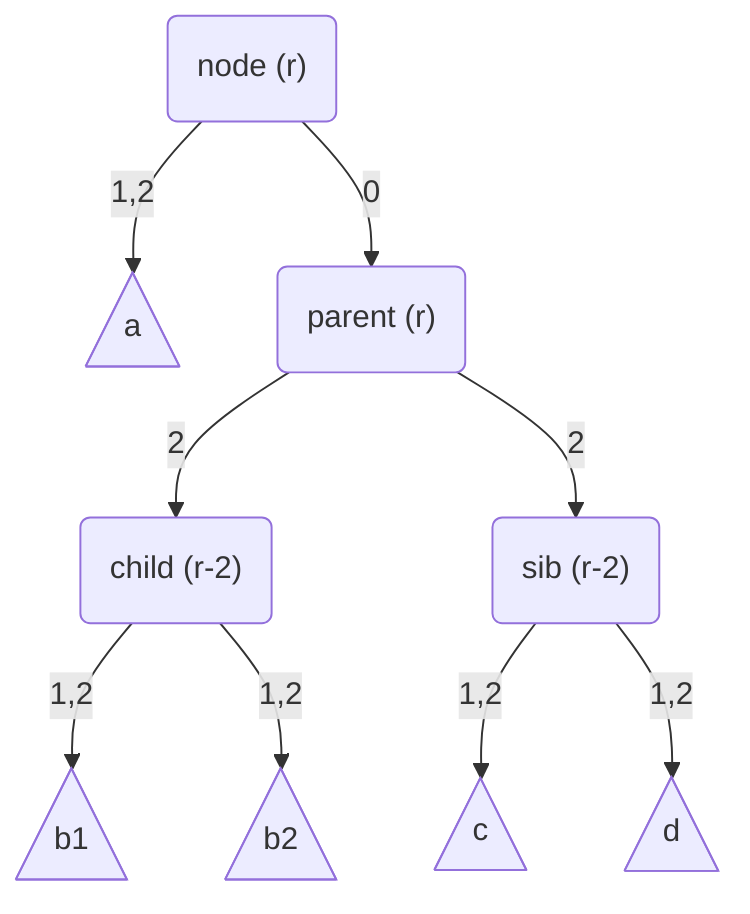

然后我们再将 `parent` 节点的 rank 值递减，得到：

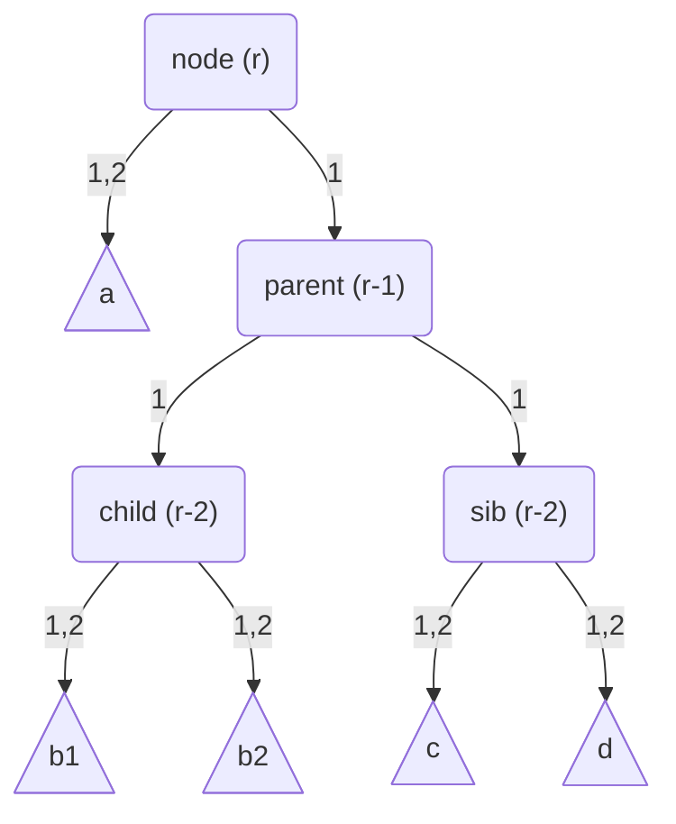

此时以 `node` 为根节点的子树已经拥有 WAVL 树的性质。另外，在旋转前后，整棵子树的根节点的 rank 值并没有发生变化，因此此时我们已经不再需要继续向上进一步考虑 `node` 节点及其父节点的 rank 值关系了。插入操作在经过一次旋转之后已经重新平衡了整棵 WAVL 树，插入结束。

如果 `child` 节点的 rank 值为 $r-1$：


细心的读者一定注意到了示意图中的一个小差异，即 `node` 节点与子树 `a` 的根节点的 rank 值之差在这种情况下一定为 2 。这是因为，当初在递增 `node` 节点的 rank 值之前，`node` 节点和 `child` 节点的 rank 值之差为 0 。这说明插入操作新插入的节点一定在以 `child` 为根的子树内（这也蕴含了 `child` 节点此时不可能为一个外部节点），`node` 节点与子树 `a` 的根节点的 rank 值之差一定为 1 。因此在递增 `node` 节点的 rank 值之后，`node` 节点与子树 `a` 的根节点的 rank 值之差一定为 2 。

此时需要执行两次旋转操作。首先，在 `node` 节点处执行一次左旋转，将 `child` 节点旋转到 `node` 节点的位置上：

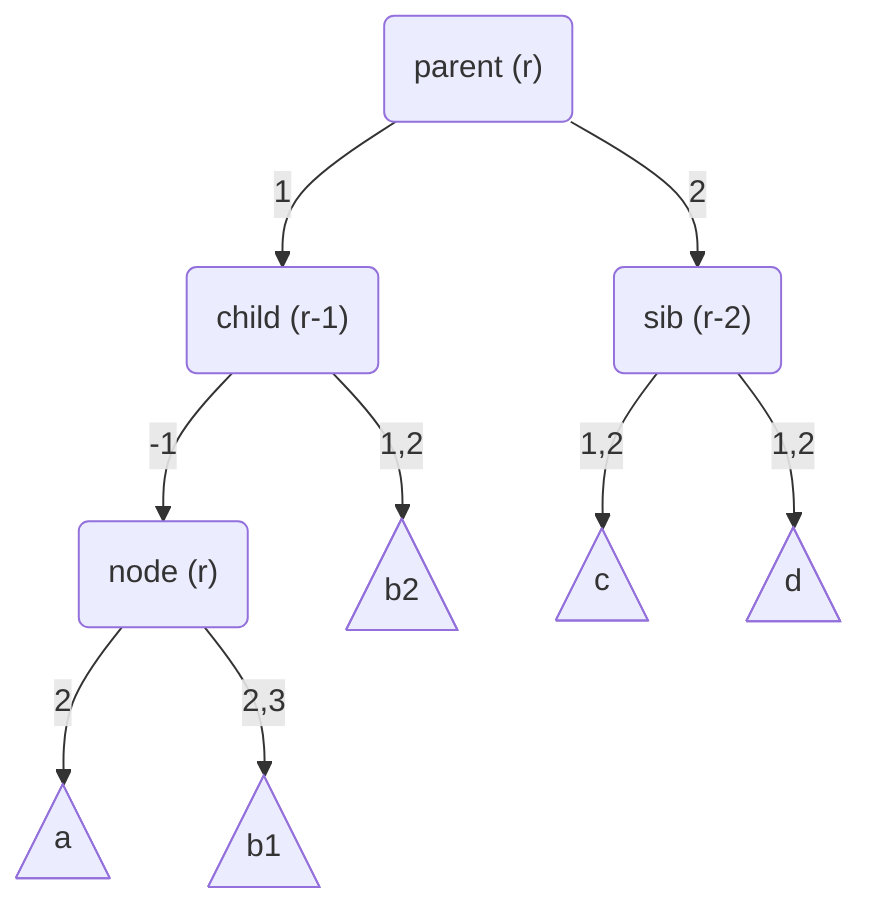

然后，在 `parent` 节点处执行一次右旋转，将 `child` 节点进一步旋转到 `parent` 节点的位置上：

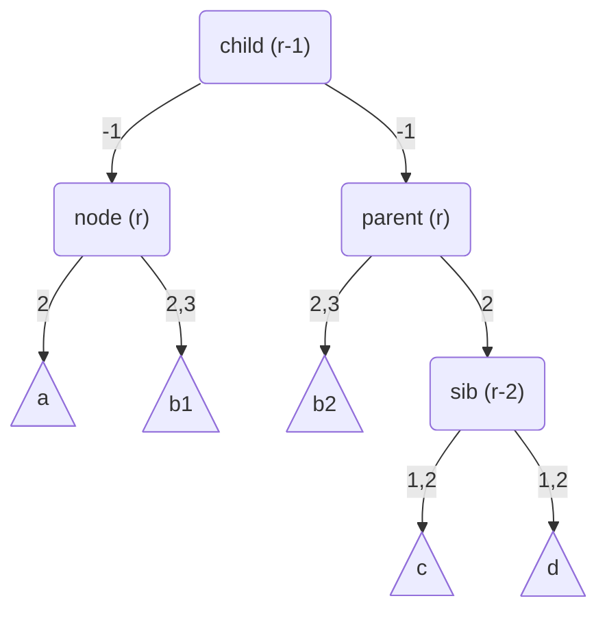

最后，调整一下 rank 值。将 `child` 节点的 rank 值调整为 $r$ ，将 `node` 节点和 `parent` 节点的 rank 值调整为 $r-1$ 。最终得到：

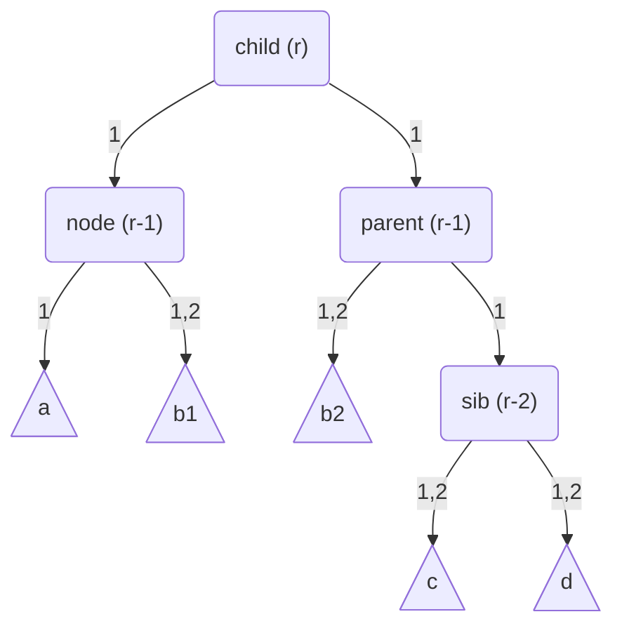

此时所有 WAVL 树的性质均已恢复。同样地，由于整棵子树的根节点的 rank 值并没有发生变化，我们不再需要继续沿着树结构向上进一步考虑 `child` 节点与其父节点的 rank 值关系。插入操作在经过两次旋转之后已经重新平衡了整棵 WAVL 树，插入结束。

综上，所有和插入操作有关的重新平衡情况均已考虑完毕。每次 WAVL 树的插入操作可能需要 $O\left(\log n\right)$ 次调整节点 rank 值的操作和至多两次旋转操作。

<Callout>
    注意力惊人的读者可能会发现，插入操作的过程中并不会产生 $\left(2,2\right)$-节点。事实上，如果不执行删除操作，只执行插入操作，那么产生的 WAVL 树将也会是一棵合法的 AVL 树。
</Callout>

### 删除

当需要删除一个节点时，与所有二叉搜索树一样，需要考虑三种情况：

1. 如果这个节点是一个叶节点，那么直接把它删除即可。
2. 否则，如果这个节点的左子节点或右子节点是一个外部节点，那么使用它的右子节点或左子节点替换它即可。
3. 否则，需要首先找到要删除的节点在以其自身为根的子树中的后继节点（即以要删除的节点的右子节点为根的子树内键值最小的节点）。然后将要删除的节点与其后继节点的键值进行交换。交换键值后，再删除后继节点即可。由于后继节点的左子节点一定是外部节点，因此删除后继节点时只需要考虑前两种情况即可。

按照二叉搜索树的通用方法删除一个节点后，与插入的情况类似，可能会导致节点的 rank 值不再满足 WAVL 树的性质。此时也需要进行重新平衡操作以恢复 WAVL 树的性质。与插入类似，重新平衡的过程从被实际删除的节点处开始，这个节点在被删除之前一定有至少一个子节点是外部节点。

#### 删除叶子的情况

当被实际删除的节点是一个叶子时，观察被删除节点的父节点。如果在删除叶节点后，其父节点成为了一个新的叶节点，那么父节点的 rank 值一定为 2 。这是因为，被删除的叶子节点的兄弟节点一定是一个外部节点（否则删除叶节点后其父节点不会成为新的叶节点），而外部节点的 rank 值为 0 ，因此父节点的 rank 值一定为 2 。WAVL 树不允许出现 rank 值为 2 的叶节点，因此需要将父节点的 rank 值递减，使其变为 1 。然后，与插入操作类似，我们需要沿着树结构向上一级，继续考虑父节点与其父节点的 rank 值关系。

如果被删除的叶节点的父节点在删除叶节点后并没有成为一个新的叶节点，此时我们可以把删除叶节点这一操作看成是将被删除叶节点的 rank 值递减使其变为 0 。这与在树内处理节点 rank 值递减的情况相同，将在下一节讨论。

#### 树内部的情况

前文提到，在删除操作的过程中，会出现将某些节点的 rank 值递减的操作。在节点的 rank 值递减后，需要继续考虑该节点与其父节点的 rank 值关系。记 rank 值被递减的节点为 `node` 节点，其父节点为 `parent` 节点，其兄弟节点为 `sibling` 节点。记 `node` 节点的 rank 值在递减后为 $r$ ，那么 `parent` 节点和 `sibling` 节点的 rank 值将可能有四种组合情况：

| # | `parent` 节点的 rank 值 | `sibling` 节点的 rank 值 |
|---|---|---|
| 1 | $r + 2$ | $r$ |
| 2 | $r + 2$ | $r + 1$ |
| 3 | $r + 3$ | $r + 1$ |
| 4 | $r + 3$ | $r + 2$ |

在第 1 和第 2 种情况下，WAVL 树的性质已经满足，可以直接结束删除操作。

对于第 3 种情况，可以直接将 `parent` 节点的 rank 值递减，使得 `parent` 节点和 `node` 节点的 rank 值之差重新变为 1 或 2 即可。然后继续沿着树结构向上一级，继续考虑 `parent` 节点与其父节点的 rank 值关系。

对于第 4 种情况，则需要继续考虑 `sibling` 节点的子节点的 rank 值情况。如果 `sibling` 节点的两个子节点（其中可能有外部节点）的 rank 值均为 $r$ ：

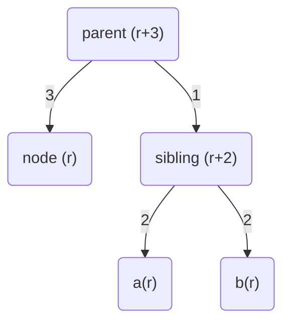

此时我们可以同时将 `parent` 节点和 `sibling` 节点的 rank 值递减 ，得到：


此时 WAVL 树的性质已经恢复，但由于 `parent` 节点的 rank 值被递减，因此需要向上继续考虑 `parent` 节点与其父节点的 rank 值关系。

如果 `sibling` 节点的两个子节点（其中可能有外部节点）的 rank 值均为 $r+1$ ：

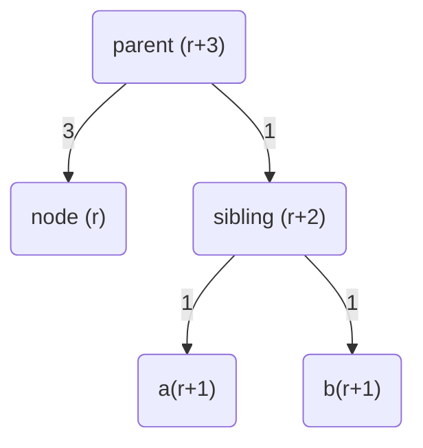

此时需要进行一次旋转操作来重新平衡 WAVL 树。在 `parent` 节点处执行一次左旋转操作，将 `sibling` 节点旋转到 `parent` 节点的位置上，得到：

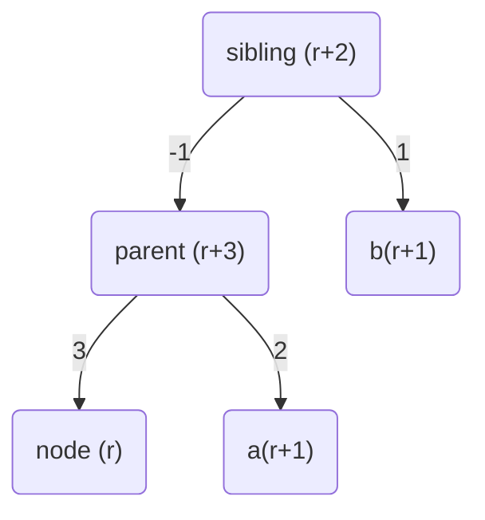

然后再将 `sibling` 节点的 rank 值调整为 $r+3$ ，将 `parent` 节点的 rank 值调整为 $r+2$ ，得到：

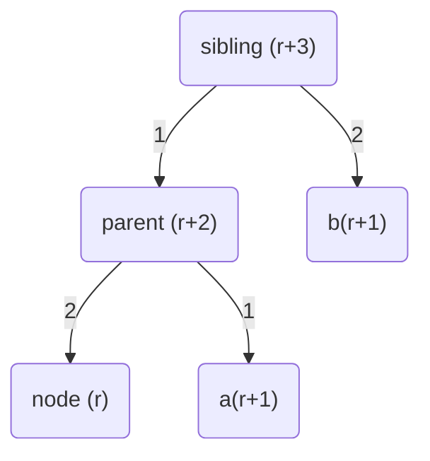

此时 WAVL 树的性质已经恢复。由于没有改变整棵子树的根节点的 rank 值，因此不需要继续向上重新平衡，可以结束删除操作。

如果 `sibling` 节点的两个子节点（其中可能有外部节点）的 rank 值分别为 $r$ 和 $r+1$ ，则需要进一步考虑哪个 `sibling` 的子节点的 rank 值为 $r$ 或 $r+1$ 。本文以 `sibling` 节点为 `parent` 节点的右子节点为例，

如果 `sibling` 节点的右子节点 `sib_right` 的 rank 值为 $r+1$ ：

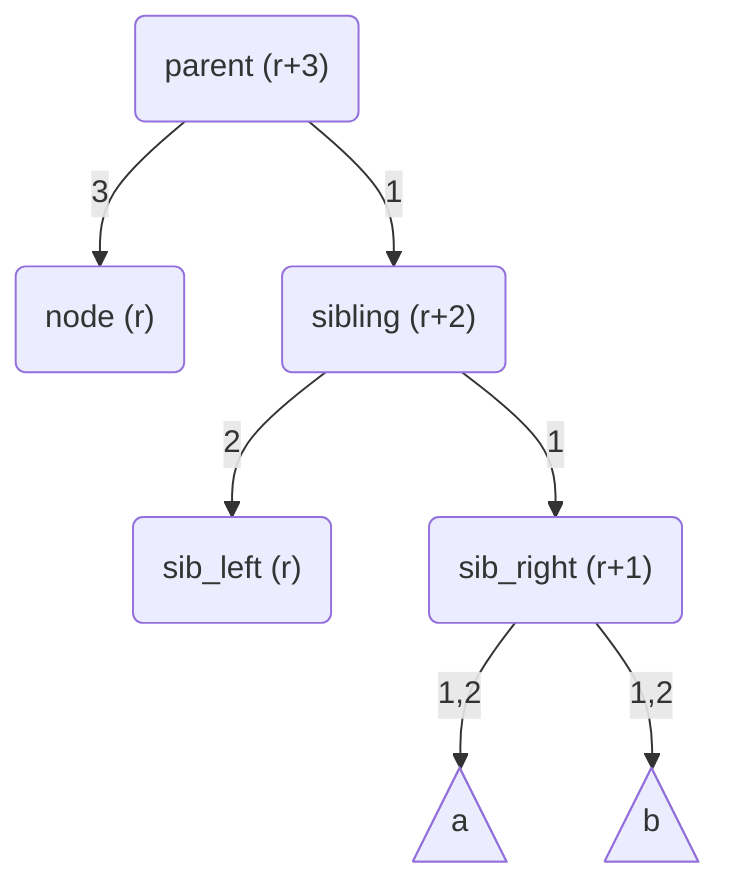

此时可以通过在 `parent` 节点处执行一次左旋转操作，将 `sibling` 节点旋转到 `parent` 节点的位置上，得到：

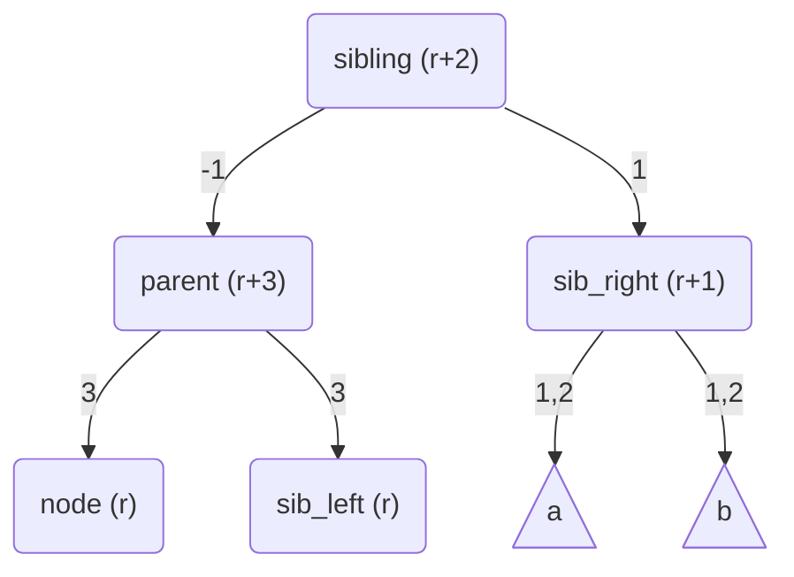

然后将 `sibling` 节点的 rank 值调整为 $r+3$ ，将 `parent` 节点的 rank 值调整为 $r+2$ ，最终得到：

```mermaid
flowchart TD
    sibling("sibling (r+3)")
    parent("parent (r+2)")
    sib_right("sib_right (r+1)")
    node("node (r)")
    sib_left("sib_left (r)")

    subtree_a@{ shape: tri, label: "a" }
    subtree_b@{ shape: tri, label: "b" }

    sibling -- 1 --> parent
    sibling -- 2 --> sib_right
    parent -- 2 --> node
    parent -- 2 --> sib_left
    sib_right -- 1,2 --> subtree_a
    sib_right -- 1,2 --> subtree_b
```

此时 WAVL 树的性质已经恢复，且由于整棵子树的根节点的 rank 值没有发生变化，删除操作可以结束。

如果 `sibling` 节点的左子节点 `sib_left` 的 rank 值为 $r+1$ ：

```mermaid
flowchart TD
    parent("parent (r+3)")
    node("node (r)")

    sibling("sibling (r+2)")
    sib_left("sib_left (r+1)")
    sib_right("sib_right (r)")

    subtree_a@{ shape: tri, label: "a" }
    subtree_b@{ shape: tri, label: "b" }

    parent -- 3 --> node
    parent -- 1 --> sibling
    sibling -- 1 --> sib_left
    sibling -- 2 --> sib_right
    sib_left -- 1,2 --> subtree_a
    sib_left -- 1,2 --> subtree_b
```

此时需要两次执行旋转操作。首先在 `sibling` 节点处执行一次右旋转，将 `sib_left` 节点旋转到 `sibling` 节点的位置上；然后再在 `parent` 节点处执行一次左旋转，将 `sib_left` 节点旋转到 `parent` 节点的位置上。得到：

```mermaid
flowchart TD
    sib_left("sib_left (r+1)")
    parent("parent (r+3)")
    sibling("sibling (r+2)")
    node("node (r)")
    subtree_a@{ shape: tri, label: "a" }
    subtree_b@{ shape: tri, label: "b" }
    sib_right("sib_right (r)")

    sib_left -- -2 --> parent
    sib_left -- -1 --> sibling
    parent -- 3 --> node
    parent -- 3,4 --> subtree_a
    sibling -- 2,3 --> subtree_b
    sibling -- 2 --> sib_right
```

然后再将 `sib_left` 节点的 rank 值调整为 $r+3$ ，将 `parent` 节点和 `sibling` 节点的 rank 值均调整为 $r+1$ ，最终得到：

```mermaid
flowchart TD
    sib_left("sib_left (r+3)")
    parent("parent (r+1)")
    sibling("sibling (r+1)")
    node("node (r)")
    subtree_a@{ shape: tri, label: "a" }
    subtree_b@{ shape: tri, label: "b" }
    sib_right("sib_right (r)")

    sib_left -- 2 --> parent
    sib_left -- 2 --> sibling
    parent -- 1 --> node
    parent -- 1,2 --> subtree_a
    sibling -- 1,2 --> subtree_b
    sibling -- 1 --> sib_right
```

此时 WAVL 树的性质已经恢复，同样由于整棵子树的根节点的 rank 值没有发生变化，删除操作可以结束。

综上，所有和删除操作有关的重新平衡情况也已经全部考虑完毕。每次 WAVL 树的删除操作可能需要 $O\left(\log n\right)$ 次调整节点 rank 值的操作和至多两次旋转操作。

## 优化实现

WAVL 树上的每个节点都有一个整数 rank 值。但在实际的实现中，与红黑树类似，每个 WAVL 树节点其实只需要一个额外的 bit 来记录 rank 。这里的技巧在于，WAVL 树的实现其实并不关心每个节点的 rank 值具体是多少，而只关心每个（非根）节点的父节点与该节点的 rank 值之差。WAVL 树中每个（非根）节点的父节点与该节点的 rank 值之差只能为 1 或 2 两种情况，因此在实现上，最少只需要花费一个额外的 bit 记录每个 WAVL 树节点属于哪种情况即可。

## WAVL 树的实际应用

WAVL 树是一个相对来说比较新的数据结构，其在工业界的实际应用目前并不广泛。和目前应用最为广泛的红黑树相比，WAVL 树的主要优势在于其平均高度较低，在查询密集的场景下可能会取得比红黑树更好的性能表现。另外，在复杂程度上，WAVL 树的原理比红黑树更好理解，实现难度也比红黑树更低一些。

LLVM 项目的子项目 [llvm-libc](https://libc.llvm.org/) 最近合并了一个 [PR](https://github.com/llvm/llvm-project/pull/172411) ，该 PR 使用 WAVL 树实现了 libc 中的 [`tsearch`](https://www.mankier.com/3/tsearch) 系列函数。这个 PR 的测试结果显示，与在内部使用红黑树的其他 `tsearch` 实现相比，使用 WAVL 树的实现在大部分测试场景下都取得了更好的性能表现。

## 参考文献

1. [Rank-Based Trees](https://sidsen.azurewebsites.net/papers/rb-trees-talg.pdf) by Bernhard Haeupler, Siddhartha Sen, Robert E. Tarjan
2. [Weak AVL Tree](https://maskray.me/blog/2025-12-14-weak-avl-tree) by MaskRay
